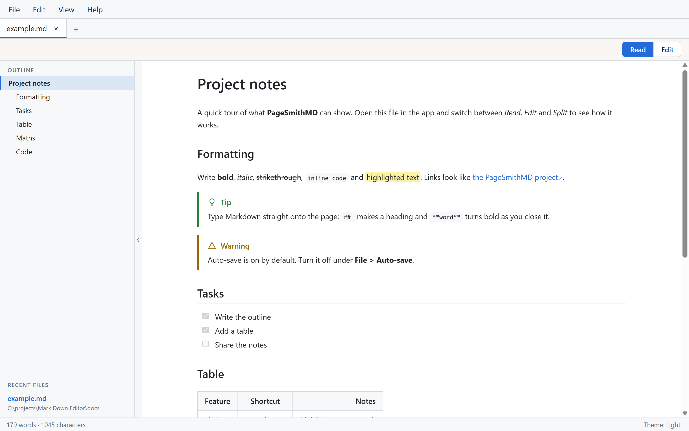
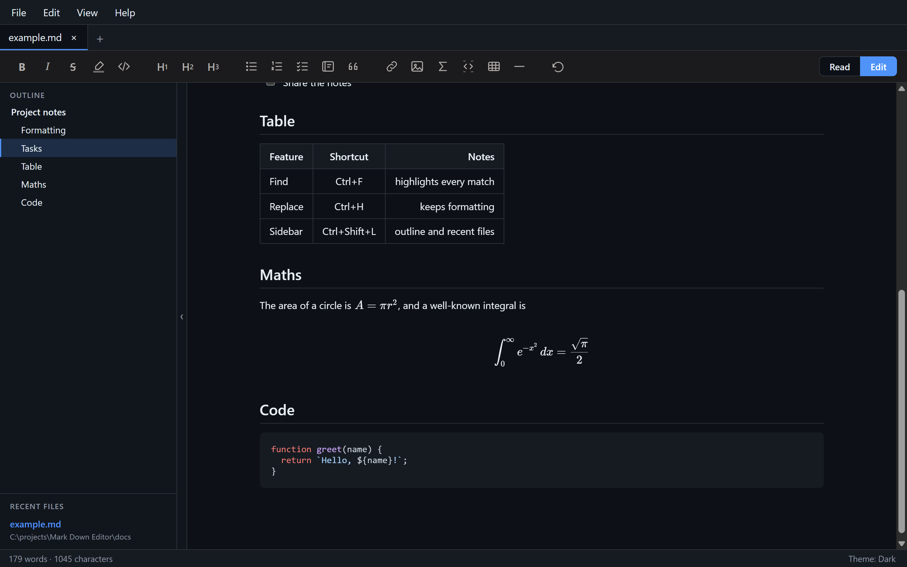
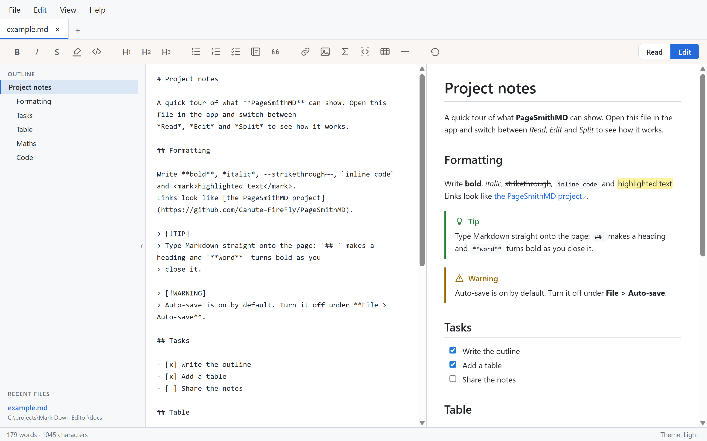

# PageSmithMD

**A simple, free Markdown viewer and editor for Windows.** Read your `.md` files the way they look
on GitHub, or edit them right on the page, like a word processor, while PageSmithMD keeps the
Markdown tidy underneath.

## Features

**Read and edit**
- **Three modes:** *Read* (nothing changes by accident), *Edit* (type straight onto the formatted
  page) and *Split* (the Markdown on the left, the page on the right, both editable and in sync).
- **Tabs:** every file opens in its own tab; drag files onto the window to open them.
- **Markdown shortcuts as you type:** `# ` makes a heading, `- ` a list, `[ ] ` a task, `> ` a quote,
  and `**bold**`, `*italic*`, `` `code` ``, `==highlight==` or `$x^2$` turn into formatting as you
  close them. Ctrl+Z straight after puts the characters back.
- **Paste Markdown** from anywhere and it arrives formatted (Ctrl+Shift+V pastes it as plain text).
- **Formatting toolbar** for everything else: headings, lists, tasks, quotes, callouts, links,
  images, formulas, code blocks, tables and horizontal rules.

**Write richer documents**
- **Tables** with a small toolbar to add or remove rows and columns and set column alignment;
  Tab and Enter move between cells.
- **Maths** with KaTeX: `$E = mc^2$` inline and `$$ … $$` blocks; double-click a formula to edit it.
- **Callouts** in GitHub's style: `> [!NOTE]`, `[!TIP]`, `[!IMPORTANT]`, `[!WARNING]`, `[!CAUTION]`.
- **Highlights**, saved as `<mark>` so GitHub shows them too (`==text==` from Typora or Obsidian
  works as well).
- **Images:** paste a screenshot or drop a picture and it's saved in an `images` folder next to the
  document, linked with a relative path.
- **Links:** Ctrl+K to add or edit one, or paste a web address over selected words. Links to
  websites open in your browser; links to pictures, PDFs and other documents ask first, and links
  never start programs or scripts.
- **Front matter** (the `---` block of settings some sites and apps use) is shown neatly and never
  changed by editing the page.
- **Code blocks** with syntax highlighting.

**Find your way around**
- **Outline sidebar** of the document's headings (click to jump), plus your **recent files**.
- **Find and replace** (Ctrl+F / Ctrl+H) with match case and whole word.
- **Reopen last session:** your files come back where you left them.

**Never lose work**
- **Auto-save** a couple of seconds after you stop typing (can be turned off). It won't overwrite a
  file another program has changed.
- **Crash recovery:** if PageSmithMD or Windows closes unexpectedly, unsaved changes are offered
  back next time.

**Looks after your eyes and files**
- **Light, dark or follow Windows**, including a larger, theme-aware menu bar.
- Keeps each file's line endings (Windows or Unix) as they were. Files are read and written as UTF-8.
- **Print and export to PDF.**

## Install
Download from the [Releases page](https://github.com/Canute-FireFly/PageSmithMD/releases):

- **PageSmithMD-Setup-&lt;version&gt;.exe**: installs for your Windows account (no admin rights
  needed), adds Start menu and Desktop shortcuts and registers .md / .markdown / .mdown / .mkd files.
  Uninstall from Settings > Apps; your settings are kept.
- **PageSmithMD-&lt;version&gt;-portable.zip**: unzip anywhere and run `PageSmithMD.exe`.

Windows 11 doesn't let an app make itself the default, so do this once: right-click a .md file >
**Open with** > **Choose another app** > **PageSmithMD** > **Always**.

The builds aren't code-signed yet, so Windows may show "Windows protected your PC" the first time:
choose **More info** > **Run anyway**.

Want a quick tour? Open [docs/example.md](docs/example.md) in PageSmithMD.

## Keyboard shortcuts

| Action | Keys | | Action | Keys |
|---|---|---|---|---|
| New / Open | Ctrl+N / Ctrl+O | | Bold / Italic | Ctrl+B / Ctrl+I |
| Save / Save as | Ctrl+S / Ctrl+Shift+S | | Highlight | Ctrl+Shift+H |
| Close tab | Ctrl+W | | Link | Ctrl+K |
| Next / previous tab | Ctrl+Tab / Ctrl+Shift+Tab | | Find / Replace | Ctrl+F / Ctrl+H |
| Read / Edit / Split | Ctrl+1 / Ctrl+2 / Ctrl+3 | | Next match | Enter or F3 |
| Show or hide sidebar | Ctrl+Shift+L | | Paste as plain text | Ctrl+Shift+V |
| Print | Ctrl+P | | Menus | Alt, then arrow keys |

In a table: **Tab** / **Shift+Tab** move between cells and **Enter** moves down a row.

## Settings and privacy
Settings (theme, sidebar, recent files, last session and the options in the menus) are saved for
your Windows account in `%APPDATA%\PageSmithMD\settings.json`; delete it to start afresh. Unsaved
changes kept for crash recovery live in `%APPDATA%\PageSmithMD\recovery` and are removed when you
exit normally.

PageSmithMD doesn't collect or send any data. It only goes online to show pictures that a document
links from the web, when you open a link, and to check GitHub for a newer version (see below).

## Updates
The installed app checks GitHub for a new version a few seconds after it starts, and you can check
any time with **Help > Check for updates**. It always asks before downloading; a downloaded update
installs when you restart or close PageSmithMD. Turn the automatic check off with
**Help > Check for updates automatically**. The portable version tells you about a new version and
opens the download page.

## Build from source
You need [Node.js](https://nodejs.org/) 20 or later.

    npm install
    npm start [file.md]      run from source
    npm run dist             build the installer and portable zip into release\installer

See [CONTRIBUTING.md](CONTRIBUTING.md) for how the code is organised and how to send changes.

Developer shortcut (no installer): `npm run package`, then `install.ps1` / `uninstall.ps1`
install or remove the build in `%LOCALAPPDATA%\Programs\PageSmithMD` for the current user.
Don't mix this with the Setup installer on the same PC; uninstall one before using the other.

## Feedback
Found a bug or have an idea? [Open an issue](https://github.com/Canute-FireFly/PageSmithMD/issues).
For security problems, please follow [SECURITY.md](SECURITY.md) instead of opening a public issue.

## Licence
PageSmithMD is free and open source under the [MIT licence](LICENSE). Copyright (c) 2026 John Moore.
It includes open-source components under their own licences; see
[THIRD-PARTY-NOTICES.md](THIRD-PARTY-NOTICES.md) (also under **Help > Licences** in the app).
